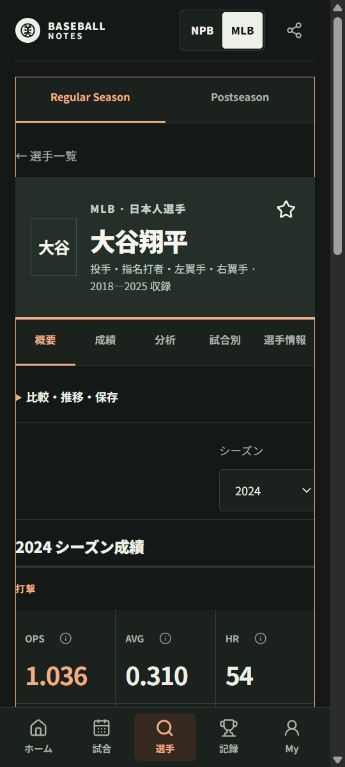
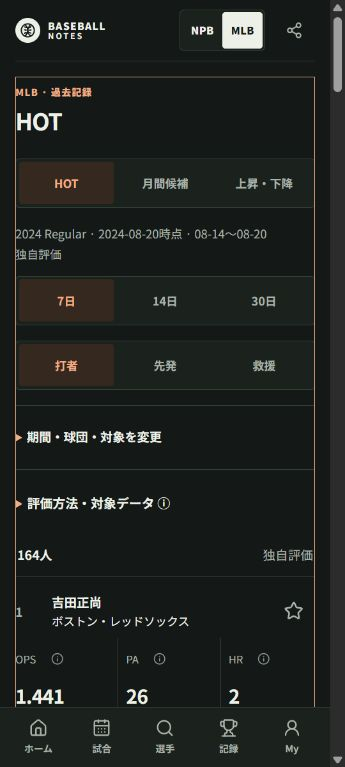
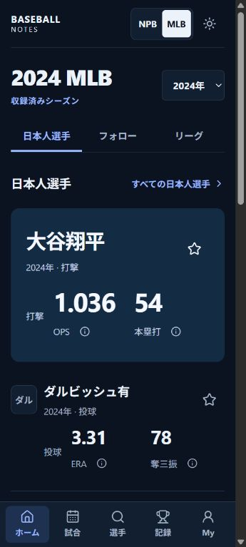

# Final UI reconstruction — delivery and QA

2026-10-12, PR [#26](https://github.com/tomoya41/baseball-notes/pull/26). This is the pre-publication checkpoint; the PR delivery comment records the final merge/deployment/HTTP results.

## Delivered presentation

Sports Broadcast × Scouting Report replaces the scorebook palette and generic section repetition. Real names and role-specific recorded statistics lead Player; symmetric scores lead Game; the leading HOT player has a distinct rank composition followed by compact rows. MLB Home features Japanese/followed players within a selected Historical year. NPB Home keeps actual saved results and explicit current-date uncertainty. Team has a visible W/L/T record. Explorer and comparison results precede secondary navigation and disclosed controls. Empty My gives useful follow entry points plus organization rather than repeated empty dashboard panels.

Five primary destinations, one natural document scroll, canonical routes/query validation, all existing product functions and state namespaces remain. No source, image/logo acquisition, external font, dependency, DB write, metric formula, qualifier, Gate or public data projection is changed.

Research and per-family inventory: [astra-reconstruction-research.md](astra-reconstruction-research.md). Tokens/primitives: [design-system.md](design-system.md). Dark is a separate navy palette, not an inverted Light theme. Basic actions use Lucide; the old handmade equipment-icon module and stale preview guidance were removed.

## Representative Before / After

Native browser captures are JPEG. They were viewed, not inferred from code or tests. The viewport was 360×800; the capture contains the visible document area excluding browser chrome/scrollbar. The older Home tab returned a downscaled raster despite correct DOM dimensions; that invalid baseline capture is deliberately excluded.

| Screen | Before | After |
|---|---|---|
| Player · 2024 Regular |  |  |
| HOT · 2024-08-20 / 7 days |  |  |

These show real existing public data, not fixtures or competitor assets. Retrosheet/Chadwick and Wikipedia field attribution remain in the app's source/provenance surfaces.

## Actual browser checks and boundaries

The public baseline and local application were operated in Chrome. The 360px audit included NPB/MLB Home, calendars, canonical games/Recap, Player overview and detailed Stats/Analysis/Game Log/Trends/history, Team, Records, Data/Recent/Season exploration, Player/Team/Season comparison, exact-PA MATCHUP, Postseason Hub/Series, Draft/young/school, milestones, My/Watch, Collections/Saved Views/Activity, glossary, source/privacy and unsupported/future routes. Named results, dates/scopes and document widths were inspected; zero horizontal document overflow was observed in the completed samples. Loading-transition images were not treated as final visual evidence.

Actual interaction checks include Recent period URL change and browser Back/reload restoration; portable canonical links; local metric dialog, native Escape and return focus to its original ⓘ button; and Light/Dark switching. Existing tests cover broader scope/role/date/filter restoration, stale/partial data, corruption/migration/quota handling and offline saved-response semantics. They are distinct from forced network disconnection or physical-device proof.

Physical Android/TalkBack, device performance/touch comfort, signed App Links/Play release, and an actual network-disconnected browser cold launch remain manual. Data/cache and persistence tests do not prove hardware QA. Scheduled future Game Preview states and corrupted-storage states are test-verified where no such live public response was available; no production fixture or fabricated scheduled game was added.

The PR's final QA/deployment comment records the additional 390px, tablet and desktop observations and any remaining limitations.

## Review fixes

- P1 documentation reference: replace the obsolete design-system preview, remove the deleted icon-module instruction, and track the research document.
- P2 ready-but-empty NPB Season: keep its explicit absence state outside the closed overview disclosure; test the mounted Player with neither role.
- P2 duplicate appearance controls: synchronize mounted header/My selections with the applied session preference. Preserve session display when quota fails; test duplicate and newly mounted controls. No persistence schema/key is changed.
- Home role labels use the selected year's actual recorded batting/pitching sets; a batting-only 2024 two-way player remains visible without borrowing pitching roles from other years.

## Regression and performance checkpoint

- Full suite: **101 files / 1,172 tests**, lint, strict typecheck, Web and Vercel build pass at the review-fix checkpoint. Final code is rechecked in CI before merge.
- Android CI builds debug APK, release APK, unsigned release AAB and instrumentation APK. This is compile/package regression, not physical QA or production signing.
- Initial JS: about **482.43KB / 149.18KB gzip**, versus baseline 481.95 / 149.23KB. Historical reader stays lazy at 455.68 / 140.21KB. No meaningful initial-JS regression or claimed large splitting gain.
- CSS source: 86,838 → 75,812 bytes before the final minor polish; compiled CSS about 62KB / 11.4KB gzip. Explicit foundation/specialist/screen ownership replaces accumulated global overrides.
- Home adds **0 form-projection reads**; existing four-profile follow/Japan bound remains. HOT renders 20, Explorer 40, and comparison 2–4 entities. Existing monthly/shard bounds and saved-response validation remain. Recent display-role lookup now uses a memoized canonical-ID index instead of repeated linear searches.
- Before-publication HTTP: **45 contract/count/identity requests PASS**, including preserved NPB master/Season/HOT family hashes and old MLB 2025 Season/Records hashes; admitted Regular 27,623 games and Postseason 472 games across twelve years. App-only publication must preserve the entire staged data release as well as these HTTP samples.
- Git diff has no domain/application/infrastructure/data/pipeline/source/workflow changes. Canonical DB writes for this delivery: **0**. NPB partial coverage and closed HOT/Ranking Gates remain; MLB is Historical 2014–2025 with isolated competitions.

## Remaining source/platform work

NPB Historical/Career, Current Postseason, current roster/number, transactions/FA/Posting/preseason, unresolved identities and rights-dependent metrics/assets remain their existing Source/Data Quality tracks. MLB Current is not introduced. Browser/native push and background delivery are not promoted. Android device/TalkBack, release signing, production notification configuration and Play submission remain outside this delivery.
