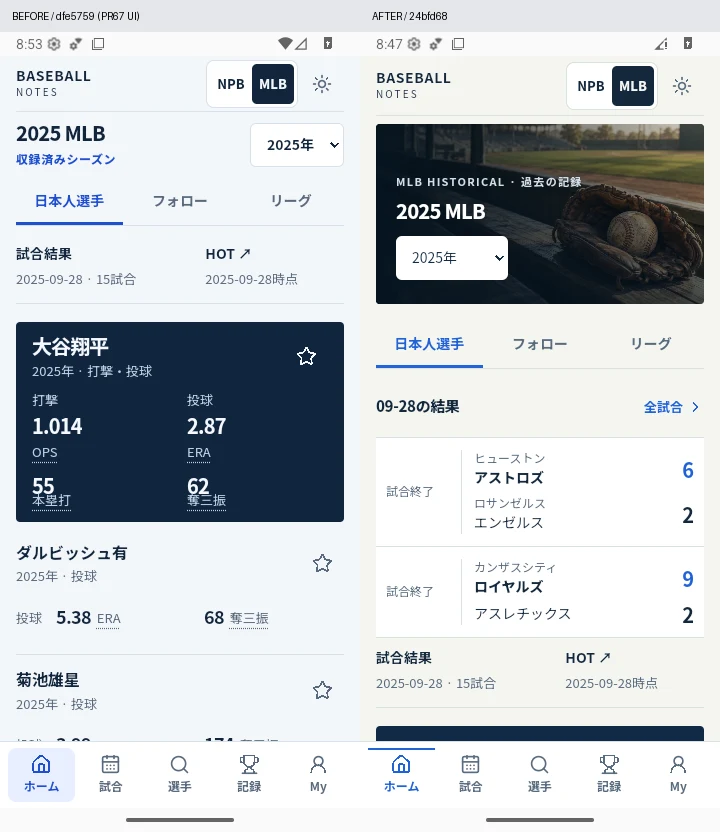
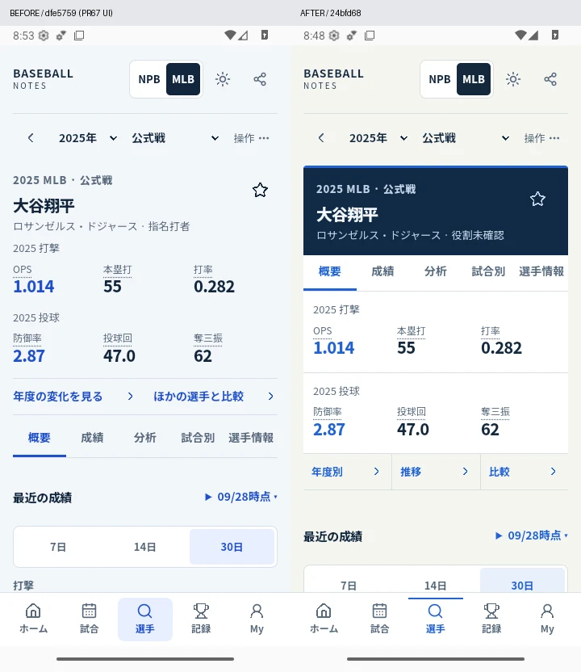
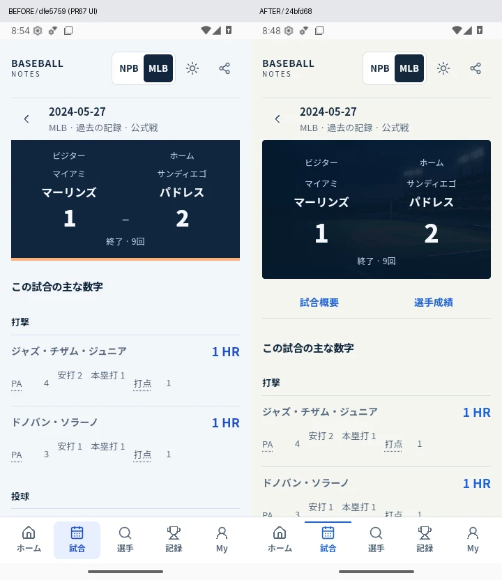
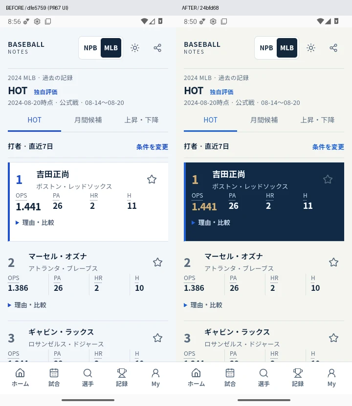
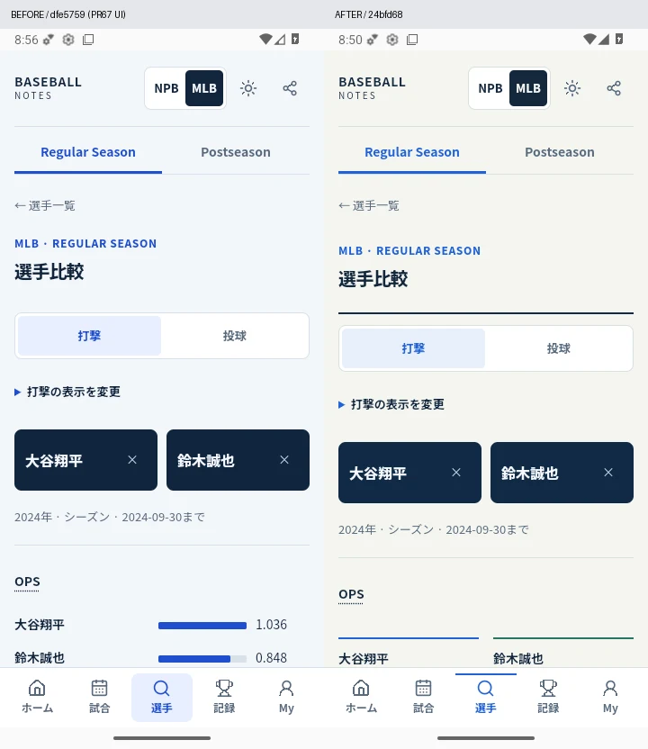
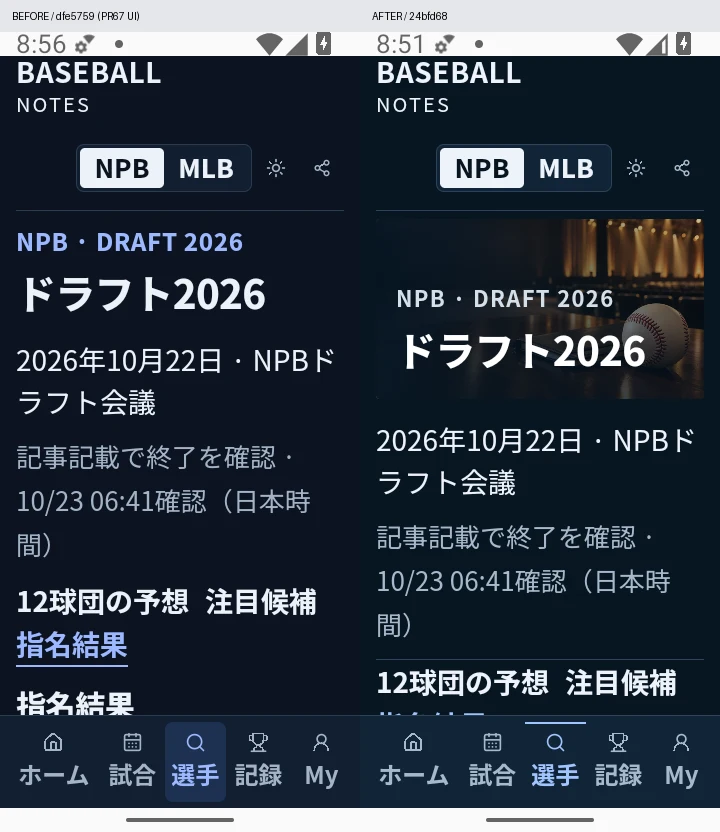
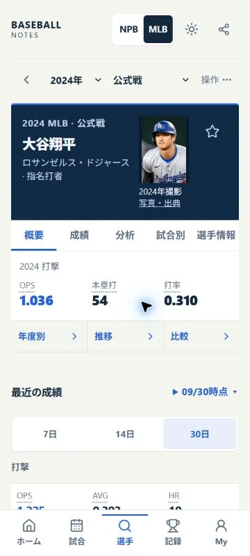

# Baseball Notes — full-screen editorial redesign

Baseline: main `e4c73be` (PR #67), 2026-10-23. The supplied twelve-screen concept is the visual direction, not a source of real players, logos, results, live innings or advanced data. Delivery now includes review, merge and Pages only after validation (the user's later authorization supersedes the initial PR-only stop).

## Direction and migration

**Everyday clarity, event atmosphere, useful depth.** Navy score stages, white/quiet statistical surfaces, editorial event covers. Standard phone body remains 14px; identities 20px; captions 12px; only scores receive large numerical emphasis. Android font scaling remains native. No external fonts.

The old interface put menus/seasonal text before games and hid both box scores inside independent disclosures. Home now starts with stored results, games offer a direct in-page jump and one selected team, and profiles place navigation immediately after identity. New visual assets belong to events/history, not every statistical card. Shared shell/controls apply to every route; Games, Player, data exploration and editorial/personal families have distinct compositions.

Affected layer: React presentation/CSS plus the bounded offline application-asset manifest. No acquisition, statistics, eligibility, canonical ID, database, public data projection or local-storage migration. Revert these presentation commits to roll back; existing pinned data and local keys remain usable. New `boxSide` is optional, retains all existing query values, and falls back to away for legacy URLs. Both teams are already loaded; changing the selected team makes no request.

## Competitive evidence, checked 2026-10-23

Official public descriptions/screens and the user's attached examples were inspected. Competitor native apps were not installed or measured. Public-store ratings/reviews are observations, not proof of why an app is popular.

| Reference | Observed principle adopted | Deliberately excluded |
|---|---|---|
| [NPB+ official](https://www.japan-baseball.jp/npb-plus/) | Strong player identity, score/role hierarchy and separate performance detail | Tracking, photo/logo assets, uncollected live situations |
| [Sportsnavi official](https://sports.yahoo.co.jp/promo/app/bblive/) | Game → player facts → profile; followed subjects easy to reach | Pitch-by-pitch core, ads/news body, implied real-time service |
| [Apple Sports official examples](https://www.apple.com/newsroom/2024/02/introducing-apple-sports-a-new-app-for-sports-fans/) | Opposed teams/scores; clear result before supporting actions | Betting, television features and branded gradients |
| [FotMob public store](https://play.google.com/store/apps/details?id=com.mobilefootie.wc2010&hl=en) and attached match list | Compact aligned match rows, date/status column, grouped context | Football ratings and copied assets |
| [Sofascore public UI](https://www.sofascore.com/) and attached profile | Identity/tabs before detailed content; two-subject numerical comparison | Unsupported proprietary scores/maps |
| [FanGraphs public leaders](https://www.fangraphs.com/leaders/major-league) and attached table | Semantic aligned tables; scope/metric exploration; detailed statistics below essentials | A desktop-width wall of columns at enlarged phone text |
| [MLB official](https://www.mlb.com/apps/mlb-app) | Connected player/game/history destinations | Unlicensed 2026 Current data, footage and photos |

[Sportsnavi public reviews](https://play.google.com/store/apps/details?id=jp.co.yahoo.android.sports.npb.textlive&hl=ja) include a 2026-07-26 complaint about repeated follow prompts/unwanted articles/advertising. This supports avoiding intrusive onboarding in our design; it does not establish a general sentiment or causal usability result. The pasted claim about an MLB Box Score complaint was not independently established and is not relied on.

## Screen inventory and acceptance

All existing routes are retained. This is the design/verification plan, **not** a declaration that every state was visually inspected. Actual screenshots, dimensions, unavailable data and test results belong to the delivery evidence below.

| Family | Composition / acceptance | Data boundary |
|---|---|---|
| NPB Home, standings, followed | Seasonal lead and direct Draft/Series entries, then compact saved results and followed subjects | One bounded existing results feed; additional form fetch 0; HOT closed |
| MLB Home | Historical cover/year, already-fetched results sample, one lead followed player and compact others | At most existing four profiles; selected historical year |
| Schedules, scoreboard, preview | Date navigation, status left, team names and right-aligned scores | Unknown ≠0; no invented live status |
| Regular and historical Game detail | Opposed result stage, direct box-score jump, one selected team | Both lineups preserved; all secondary fields retained |
| CS / Japan Series Game detail | Same result/row primitives, actual innings and collected player facts | Stage/partial/source preserved; unplayed results remain absent |
| Player overview / Stats | Compact season/competition row, navy identity, readable tabs, role-specific statistics | No inferred number/current affiliation; both actual roles retained |
| Player analysis / Trends / Game log | Primary results, existing graphs/samples, disclosure for conditions | Exact existing aggregates, partial chronology, canonical game links |
| Player metadata / lifecycle | Labelled profile facts and career chronology | Verified fields only; historical affiliation not current roster |
| HOT / monthly / rising-cooling | Edition, compact criteria, lead rank plus dense result list | Existing scoring, date windows, sample thresholds, closed NPB gates |
| Records / milestones | Metric-first results, rank/name/value alignment and exact period | No partial historical totals called full Career |
| Search / directory / teams | Input/results first, summary of active filters, labelled secondary tools | Existing aliases/identity; missing metadata explicit |
| Team hub / stats | Record, saved performance, games and roster | Actual saved team membership, no logo-rights expansion |
| Player / Team / Season Compare, BvP | Distinct two-subject presentation and metric-specific scales | Missing values have no bar; no new statistical interpretation |
| Explorer / Recent / saved conditions | Essential criteria then results; advanced choices disclosed | URL/Back/Reload/saved-view validation unchanged |
| NPB history / MLB history | Original archive cover, selected year/collected-range context | Partial NPB and admitted MLB years remain separate |
| Draft / young / schools | Draft editorial cover, readable prediction/results tabs and player rows | Immutable forecasts/results and eligibility exclusions preserved |
| Postseason / Series | Stadium cover, round progression and opposed series totals, game links | Played wins vs advantages, CS vs Japan Series vs Regular |
| My / Favorites / Watch / Collections | Followed subjects before organizing tools; compact personal rows | Existing baselines, read state, collection/activity keys |
| Explore / glossary / sources / privacy / settings | Clear typographic sections, ordinary controls and accessible sheets | Full license/source/metric definitions retained |
| Loading / empty / retry / unsupported / stale / saved fallback / legacy | Specific status and recovery action in the same shell | Never turn absence into zero or healthy/complete |

## Production image assets

Generated with the built-in dedicated image tool, then inspected and optimized as 960×640 WebP (quality 80). Original PNG masters stay in the local generated-images directory, not the repository. Final project files:

| Asset | Bytes | Use |
|---|---:|---|
| `src/assets/editorial/postseason-v1.webp` | 49,604 | Fictional empty night ballpark; postseason and autumn discovery |
| `src/assets/editorial/draft-v1.webp` | 40,580 | Baseball/scouting notebook in fictional empty event hall; Draft |
| `src/assets/editorial/archive-v1.webp` | 55,714 | Glove/ball on wooden stadium bench; historical exploration |

No real faces, official marks, written statistics or real-event claims. Images have empty alt text because adjacent live HTML conveys their role; all titles/results/controls remain selectable and accessible. Lazy loading, fixed intrinsic dimensions and a dark readable fallback prevent dependency on successful image loading. The three hashed WebP application assets are included in the existing versioned/verified offline shell (baseball JSON remains excluded).

Prompt set (production requirements): original photographic landscape 3:2; no people/faces, logos, lettering, watermarks, UI or results; uncluttered darker left for HTML title. Night stadium: first-base view across the diamond, floodlights, forest-green grass/navy sky, realistic geometry, no neon/CGI. Draft: ivory red-stitched ball and closed dark scouting notebook on polished wood, empty blurred event hall, restrained warm gold/charcoal. Archive: used glove/scuffed ball on quiet wooden ballpark bench, fictional historic stadium, muted olive/tobacco/parchment, tactile analog texture. These scenes are atmosphere, not source evidence.

## Rights-cleared photographs and club marks

Two dated 2024 player portraits (大谷翔平 / 山本由伸) are admitted for informational player identification, separately credited and licensed CC BY-SA 2.0. They add 42,420 bytes and appear only for the exact canonical player + 2024 season. No photo is used to infer a current number, club or roster status. Photo failures preserve the text identity. Club-logo admission is **0 NPB / 0 MLB** in this batch; the complete 42-club official-source applicability register, independent file candidates and permission routes are in [visual-assets-rights.md](visual-assets-rights.md). This does not claim all possible independent logo uses are forbidden.

## Visual evidence and actual limits

Before: Android 36 run [39926804246](https://github.com/tomoya41/baseball-notes/actions/runs/39926804246), `dfe5759`. Its UI/source files are identical to PR #67 main `e4c73be` (the only intervening difference is one documentation line). After: **`24bfd68`, [final native run 40020734636](https://github.com/tomoya41/baseball-notes/actions/runs/40020734636), all 18 tests PASS**, same test inputs, viewport and text scale. Screenshots are actual rendered screens, not mockups.

The earlier `ff1703e` native run failed three old-selector assertions: tests assumed both CS teams were visible and that the full scope explanation was not disclosed. Tests now operate the team selector/coverage disclosure and retain the source, exact-game HR, partial-scope and Back assertions. Final review found one P2: percentage-based box columns still overlapped explanation targets when browser scrollbars reduced the content width. Fixed numeric columns reserve 44px; actual 340/360/390px browser measurements and native geometry regression verify independent targets. Final Codex review on `24bfd68` reports no findings and the P2 thread is resolved.

### Same-condition Before / After

Images retain the full app viewport and are placed side-by-side, without editing statistics, text or layout. Left is Before; right is After. Default text scale is 100%, except the explicitly labelled draft image at 200%.

MLB screenshot data attribution: The information used here was obtained free of charge from and is copyrighted by Retrosheet. Interested parties may contact Retrosheet at "www.retrosheet.org". See the in-app Sources screen and [Retrosheet notice](https://www.retrosheet.org/notice.txt). Wikipedia-derived data remains under its separately linked CC BY-SA terms; source revisions are retained in the app.

Actual browser capture of the separately admitted Ohtani 2024 portrait (360px Light; this is not a simulated player):

Photo: All-Pro Reels, crop by UCinternational, [source/revision](https://commons.wikimedia.org/w/index.php?curid=152950633&oldid=1253972097), [CC BY-SA 2.0](https://creativecommons.org/licenses/by-sa/2.0/). Resized/WebP converted and shown within the app; UI by Baseball Notes. This photo-containing screenshot is also shared under CC BY-SA 2.0; that does not relicense the application's source code.

### Inspection register

| Actual view/state | Evidence / result |
|---|---|
| NPB Home, 360 Light | Seasonal cover + direct event links + saved scores visible; data date remains 2026-10-12. No Current freshness claim. |
| MLB Home, 360 Light/Dark and 600px | Native real 2025 results and four player summaries; no extra form requests. |
| MLB Player 2024, 360 Light | Dated licensed Ohtani photo, season/competition, visible name and primary stats above recent-window controls. Exact photo/season restriction checked separately. |
| MLB Player overview/analysis/trends, 360 Light | The invisible navy-on-navy name was found and fixed; no graph or missing-value calculations changed. |
| MLB Player 150% / 200%, landscape 800px | Native font scaling retained; tables use labelled rows where enlarged text requires it. Five main navigation labels remain available. |
| MLB Game / box, 360 Dark and native Light | Score-to-club association, direct focus jump, one team panel, nullable values, wrapped full names and batting order. URL-selected home side restored after reload. |
| CS list and CS Game, 360 Light | Compact score rows and per-team exact-game box. Scope/partial status and source disclosures retained; hidden team is not mistaken for missing data. |
| NPB Postseason and Japan Series, 360 Light/Dark; 200% native | Series wins/advantages remain separate, scheduled scores remain null, results not invented. |
| Draft result/forecast/candidate views, native 200% Light/Dark | Frozen forecasts, result tabs, partial/held status, filters and player rows retained. |
| HOT, 360 Dark / native Light and 200% | At standard scale the first three players are visible early. Lead rank, sample, metrics and reason/comparison disclosure retain existing meaning. |
| Records, 360 Dark/native Light | Aligned rank/name/value; metric explanations retained. |
| Player Compare, 360 Dark/native Light | Distinct two-subject values/bars; no missing value converted to zero. |
| MATCHUP / Explorer, 360 Dark | Search/criteria and empty selection instructions inspected; existing data boundaries retained. |
| NPB history, 360 Light and native large fonts | Cohort links grouped, active year/scope visible, role/name before the secondary club filter; full partial explanation remains available. |
| Cohort / age / club / career progression, native 360/200% | Existing collected-range semantics, same-school-year cohort, source links and club-year sample explanations preserved. |
| NPB Search / Team, 360 Dark | Search list, long names, club record and saved-game rows inspected. No unsupported photo/official logo. |
| My / Watch / Collections, 360 Dark | Empty/follow instructions, organization controls, unread state and saved-condition access inspected. Native persistence/offline/restart tests remain distinct. |
| Glossary / Sources, 360 Dark | Full metric interpretation and separate photograph credits remain readable. |
| Settings / dialogs / keyboard / loading / unsupported | Existing UI/native regression covers focus/close, text scaling, IME Back, source-unavailable and empty states; no production fixture data. |
| NPB regular Game and team comparison | Existing remote read restrictions prevented a successful-data visual verification. Error/recovery presentation inspected; **not** counted as Current API or DB integrity PASS. No repeated DB diagnostics attempted. |
| Browser screenshot interruption | Later browser captures timed out after the tool reconnected. Invalid/shrunken captures were excluded. Desktop DOM geometry at 1280px was checked (five navigation items, no root overflow); this is not a claim of completed desktop-browser visual inspection. Native wide-viewport captures are separate evidence. |
| Physical Pixel / TalkBack | ADB reports no attached device in this session. **NOT RUN**; not inferred from emulator success. |

The browser captures and native raw evidence remain under ignored `.data/editorial-ui/`; the six intentionally curated comparison sheets above are review deliverables. Exact native success run, final build/review and publication evidence are recorded below when complete.

### Quality assessment

The main structural gains are independently selectable box scores, immediate player context/stats, dense score lists and different editorial/data/personal compositions. Generated scenes add atmosphere without replacing HTML controls. Normal body text stays 14px, supporting text generally 12–13px, numbers are tabular, and primary scores are 36px on phones. The work is not evidence that every competitor screen or every route/state was manually inspected. NPB portraits/club marks, successful Current-only views behind the provider limit, physical TalkBack and a fresh desktop-browser capture remain material follow-up items.

### Engineering verification

- Local full suite: 173 files, 1,788 PASS + one platform-specific Windows skip. Final code's Linux [Foundation run 40019020875](https://github.com/tomoya41/baseball-notes/actions/runs/40019020875) passes all **1,789 tests / 173 files**. `npm run lint`, strict typecheck, Web build and Vercel build pass.
- Independent regressions cover URL/Back team selection, focus jump, keyboard tabs, dated photo identity and hashes, source credits, and offline WebP hashing/cache validation.
- Generated scene bytes: 145,898; photographs: 42,420. Initial JS 280,999 bytes versus 280,838 before (+161). CSS 78,447 versus 71,655 (+6,792). Versioned offline shell 42 files / 2,281,507 bytes versus 37 / 2,079,472 (+202,035, 9.7%); baseball JSON is excluded. No extra provider, subscription or paid dependency.
- Staged data verifier: 86 retained immutable files; 600 NPB historical players / 3,524 rows; CS 12 games / 179 aggregate rows; Japan Series 7 scheduled / 0 results; no source requests or canonical writes. Data/projection pins are unchanged by Git diff.
- Prepublication HTTP preservation: 25 protected assets, three old forecast versions, all 36 frozen final slots, existing result asset, manifest and icons unchanged; 33 static requests, zero canonical requests/writes. No Turso health or Current production-gate inference.
- Performance samples are bounded emulator observations, not a benchmark: Home 1,584ms, Player 1,481ms, Analysis 510ms, BvP 305ms, Game 380ms in the earlier after run. Do not interpret single-run differences as statistically established speedups.

Final validation: Android debug APK **6,791,959 B**, unsigned release AAB **5,194,710 B**; native run 40020734636 passes 18 tests. APK/AAB were built in CI; no physical device installation, signing-key operation or Play upload occurred. PR #68 contains the reviewed implementation and evidence. Publication must use the existing app-only preservation workflow; the final Pages/HTTP result is recorded in the PR delivery comment. Physical/desktop constraints above remain explicit after release.
