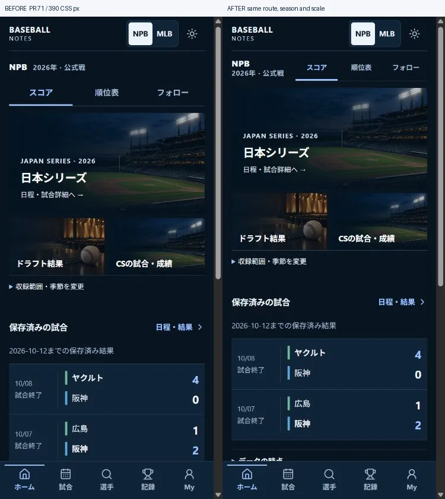
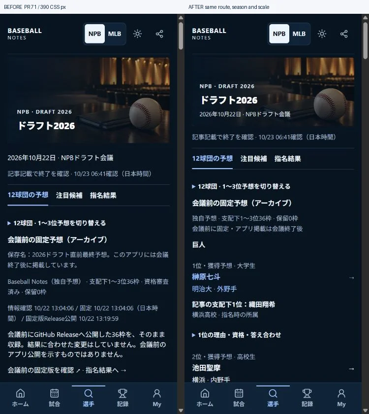
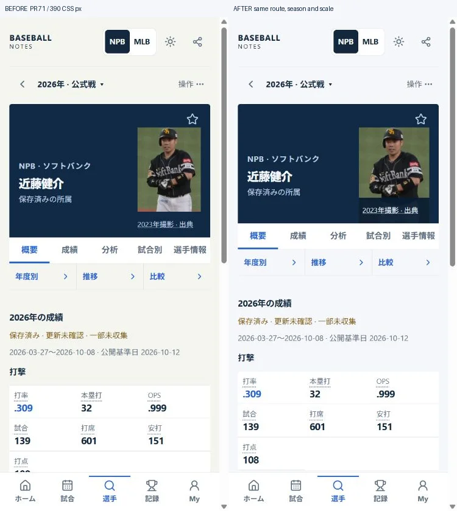
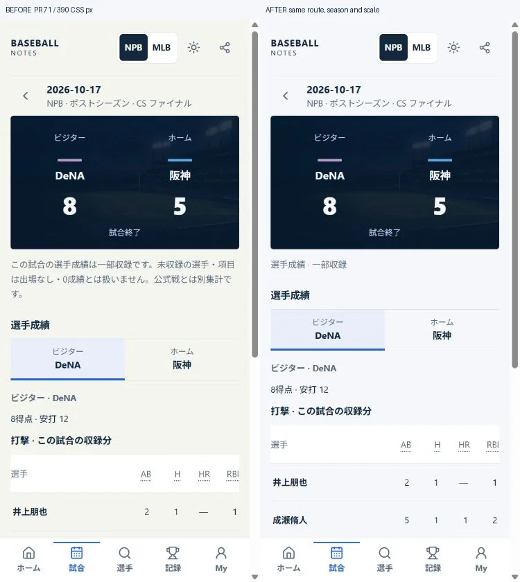

# Concept-to-screen visual review

2026-10-24 JST. Baseline: PR #71 merge `46cb9612772ee8b08312ffcf311d239814c9d80d`. The supplied twelve-screen image is an art direction, not evidence of actual photos, marks, matches, live states or statistics. This follow-up separates composition problems from unavailable assets/data. It does not claim pixel-perfect reproduction or physical-device acceptance.

## Findings and response

| Screen family | Actual comparison with the concept | Response |
|---|---|---|
| Home | Separate competition and view-control rows delay the lead story and results. | One compact context/control band, wrapping normally at enlarged native text. Existing seasonal covers and saved scores remain distinct. |
| Games | Aligned score rows already convey results quickly; missing Current detail is a retrieval problem. | Retain dense rows and explicit error recovery. Do not replace missing facts with mock scoreboards. |
| Game detail | A three-line warning occupies space between score and players. | Keep a short partial-status line, move the full limits into the existing source disclosure; keep both teams, exact observations and metric help. |
| Player | Portrait plus a separate 44px credit row makes the hero tall while the actual face is small. | A 120×164px frame and an overlaid, dated, readable 44px credit target. Existing Kondo upper-body crop is enlarged; names/stats are not enlarged. Credit returns to normal flow at large native text. |
| Stats / Analysis | Existing exact-value, gap-aware graphs and progressive metric explanations are useful. | Preserve PR #70/#71 graph, sample and calculation behavior; no decorative charts or invented tracking data. |
| Records / Ranking | Dense aligned values work; Current NPB publication remains gated. | Preserve metric explanations, qualifications and closed gates. No cosmetic removal of missing/partial/stale states. |
| Team / Search | Club → year → player now works and preserves return context. | Retain PR #71; actual club names/independent colour rails, not simulated official marks. |
| Compare / BvP | Two-subject alignment is already clearer than repeated cards. | Retain dedicated comparison composition and all scope/availability limits. |
| Draft | Fixed-edition history, multiple timestamps, aggregate outcomes and rationale precede the actual candidates. | Put event date inside the cover; shorten the cover. Show predictions and actual selection names first. Edition proof, aggregate outcomes, initial bids and full rationale remain accessible below/in labelled disclosures. The fixed forecast/results are unchanged. |
| Postseason | Score and stage are visible; game-level observations are partial. | Keep stage/played-wins/advantage separation. CS game note shortened as above; unsupported Japan Series results are not generated. |
| MLB Historical | Archive art, selected-year context and lead/secondary player hierarchy exist. | Preserve admitted 2014–2025 scopes, on-demand fetching and dated player photos; no 2026 rights expansion. |
| My / Favorites / Watch / Settings / Reference | Navigation and storage work; data and reference screens need quieter surfaces. | Shared Light palette uses a clean cool neutral and consistent borders; retain controls, source text, privacy and store keys. Dark colours and user font scaling remain intact. |

The applied Light background is `#f5f7fa`; ordinary body, captions and names retain their existing sizes. Original generated stadium/draft/archive assets are reused; **no new image was generated in this follow-up**. No additional official logo or player photograph was admitted.

## Same-condition actual Before / After

Left: PR #71 UI. Right: this follow-up. Each pair uses the same route, source data, year, theme, normal text scale and **390 CSS px** viewport. Full screenshots are arranged side by side; statistics and content were not retouched.

Home (Dark):

Draft final forecast (Dark):

Kensuke Kondo profile (Light):

Actual 2026-10-17 CS Final, DeNA–Hanshin (Light):

The draft's first predicted player is at about **509 CSS px** in the inspected 390px After view; the Before viewport is occupied by the fixed-edition explanation. In the CS pair, shortening the note brings an additional player row into view. The photograph remains explicitly dated **2023**, with its original source accessible. No mock results or generated faces appear.

Photo attribution: Kondo photograph by **Orixbaseballclub** (the Commons contributor account, not a claim of official club authorship), [original revision](https://commons.wikimedia.org/w/index.php?curid=130403896&oldid=1285332938), [CC BY-SA 4.0](https://creativecommons.org/licenses/by-sa/4.0/). Original image resized/converted to WebP and cropped by the existing CSS frame; this follow-up adjusts that frame. Wikipedia-derived screen data remains CC BY-SA 4.0; individual article/revision/author links remain in the app. These derivative comparison images retain the same attribution/license. See [the material-by-material audit](visual-assets-rights.md).

## Acceptance, limits and rollback

The PR records executed lint, strict TypeScript, full tests, Web/Vercel, Android packaging/emulator, mobile Light/Dark, tablet/desktop and public smoke results after they finish. Representative-route inspection is not a claim to have tested every possible filter, transition or data state. Tests verify that the shortened CS note still leads to the full limits, and fixed-edition proof, candidate eligibility, real results and credits remain available.

NPB Current game retrieval still has errors; its live DB integrity, freshness and HOT/Ranking are not declared healthy. Physical Pixel/TalkBack remain NOT RUN without a connected device. Official club logos remain unadmitted; separate rights review is required for additional assets. The mock's complete lineup photos, real-time play and uncollected analytics cannot be reproduced as real data.

Scope: presentation, source disclosures and their regression assertions only. No URL, canonical ID, Fact, immutable data release, gate, personal-store or Android signing migration. Rollback is a revert of this follow-up; PR #71 and all existing data remain usable. Additional monthly cost **¥0**.
