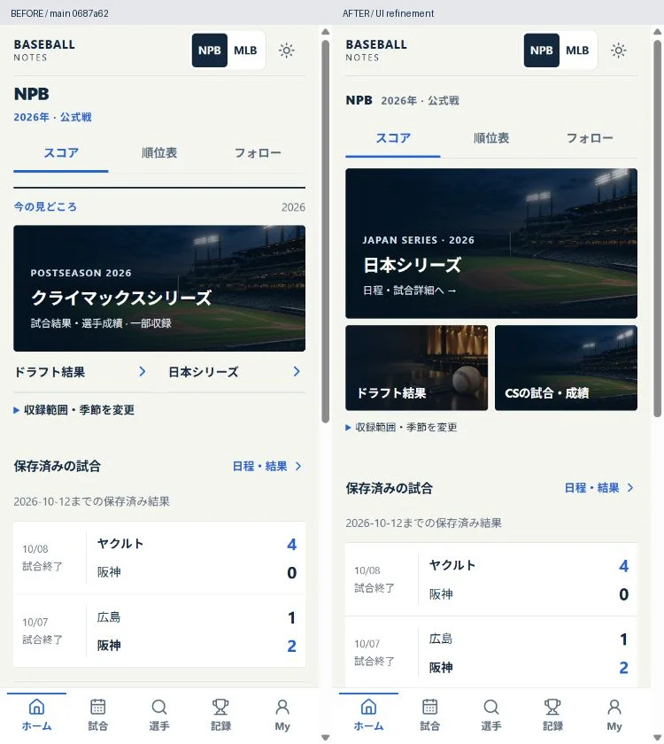
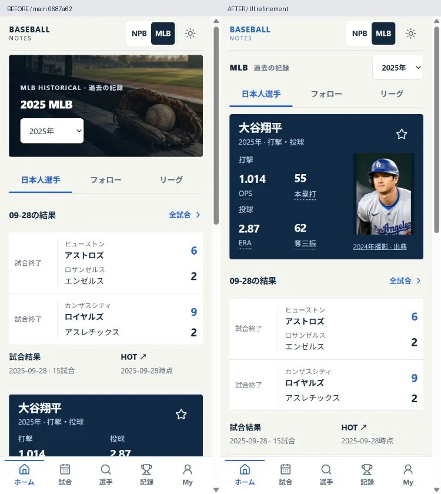
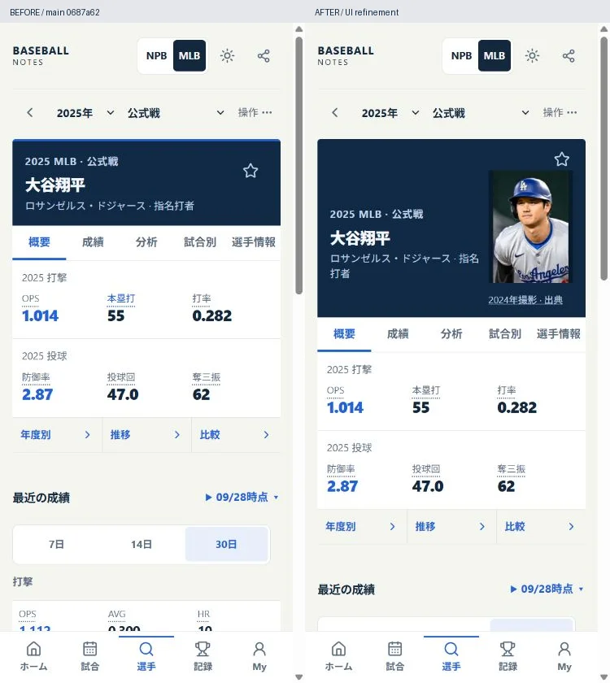

# Home and player composition follow-up

Baseline: PR #68 / main `0687a62`. Review date: 2026-10-24 JST. The previous delivery was not treated as visual acceptance: the user's supplied twelve-screen concept remains the direction.

## Actual gaps and resulting presentation

- NPB Home stacked a two-line league heading, tabs, an editorial section heading, a CS lead and text-only secondary links. Japan Series was not the lead even during its opening-week discovery window. A single compact competition line now precedes the same Home modes. A photographic lead plus two smaller image links distinguish Japan Series, Draft and CS. Only the 2026-10-24–31 Japanese-calendar discovery ordering changes; this is not a live-game, season-boundary, source freshness or played-results assertion. Outside that window the existing links remain. Every link has an explicit accessible name and its original URL. Scope, seasonal override and unavailable information remain in the adjacent disclosure.
- MLB Home placed a large generic archive cover and multiple results/context rows before its featured Japanese player. The selected Historical year now stays in a compact, labelled selector, followed immediately by one featured player and real role-specific metrics. The existing two-result sample and the remaining three compact player summaries follow it. There are still at most four existing profile requests, one existing schedule request and zero form requests; no player, year, favorite view or league view is removed.
- Player portraits were a 72×96 thumbnail and only visible on the 2024 selection. The two already admitted, independently identified MLB subjects now have a 108×144 portrait in their informational 2024–25 historical presentations, including the Home lead. “2024年撮影” and the adjacent source link are always visible. Portraits remain excluded from 2023, 2026/Current and all other identities. See [the explicit scope review](visual-assets-rights.md#2026-10-24-presentation-follow-up). No newly downloaded photograph, logo or source was adopted.
- NPB Player's verified saved uniform number was buried in a sentence. It now has its own typographic field; null/empty remain absent, an actual zero remains zero, and the saved-affiliation qualification remains visible. No number is inferred from a photograph or treated as current registration.
- Real phone inspection caught tightly adjacent OPS/HR numbers in the initial two-way Home layout. Each role now uses its own row of two separated values. Enlarged system text moves the metrics below the image rather than reducing font scale.

Standard phone body remains 14px; names and featured values are 20px. Image headings stay compact. No new decorative SVG, paid dependency, API or typography download. Obsolete cover-season/previous text-only seasonal selectors were removed after reference searches. Reverting this presentation commit restores the previous composition without data or local-storage migration.

## Verification and delivery evidence

Local full check: 173 test files, 1,790 passed + one Windows platform skip; lint, strict TypeScript, Web build and Vercel build pass. Linux CI must execute the platform test before release. Scope/unit regressions check Japanese midnight ordering, unchanged links/unavailability, exact photo identity + dated year limits, original asset hashes, preserved license credits, and null versus zero uniform numbers.

Android native regression adds real 360px Home portrait loading, non-overlapping primary numbers and 150%/200% Home screenshots in both themes, plus an NPB seasonal/saved-score screenshot. Existing Player, Games, CS, Draft, keyboard, Back, deep links, persistence and offline tests remain. These are emulator tests, not physical Pixel or TalkBack. ADB returned no connected device in this session.

Browser QA uses actual DOM/UI and screenshots at 390 CSS px (the browser capture output is 375×812 pixels), with the same dimensions for Before and After. NPB Home and MLB Home/Player were inspected in Light; NPB Home and MLB Home at 360px Dark, and MLB Home at 768/1280px Dark were inspected. No root overflow; four existing Home player summaries remain. Desktop originally spread four values across one oversized stage; the final wide layout places the lead and results in separate adjacent columns. The Home → Japan Series route shows the retained seven schedules and explicitly absent results; Back retains the Home route. Additional native/PR/Pages evidence is recorded after execution. Raw captures and logs stay in ignored `.data/ui-refinement/`; only curated comparison proof is committed.

Protected boundaries: no data pins, immutable releases, canonical identities, provider acquisition, statistics, gates, store keys, Android signing or production DB changes. The staged verifier retains 86 assets, 600 NPB Historical players / 3,524 rows, partial coverage, 12 CS games / 179 rows and Japan Series 7 scheduled games / 0 results. These are preserved release counts, not new data or live canonical integrity. Turso read restrictions remain independent; no diagnostics or retries were added.

## Acceptance still open

This focused batch is not a declaration that all supplied visual requirements are now fulfilled. Broad NPB portrait coverage, individual independently licensed club-logo files, current-data success views behind the DB restriction, physical Pixel/TalkBack and the remaining page-by-page visual acceptance remain separate work. Do not count existing generated atmospheres as new images or equate emulator success with physical-device acceptance. Additional monthly cost stays ¥0.

## Actual Before / After

Same 390×844 CSS viewport, Light, full viewport captures; left is public main `0687a62`, right is the local final presentation. Both images are identically 375×812 output pixels before adding the labelled comparison strip. The UI itself was not retouched or reconstructed.

MLB data: The information used here was obtained free of charge from and is copyrighted by Retrosheet. Interested parties may contact Retrosheet at www.retrosheet.org. Photo: All-Pro Reels, crop by UCinternational, [source/revision](https://commons.wikimedia.org/w/index.php?curid=152950633&oldid=1253972097), [CC BY-SA 2.0](https://creativecommons.org/licenses/by-sa/2.0/). Photo-containing comparison sheets are shared under CC BY-SA 2.0, without relicensing app source code. Source bytes and photo processing are unchanged from PR #68.
