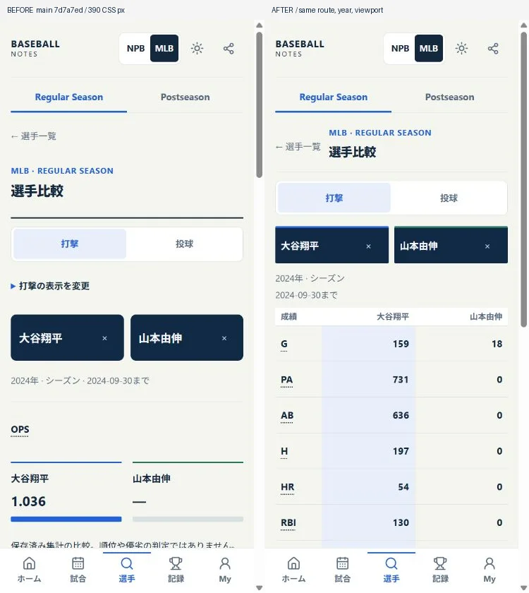
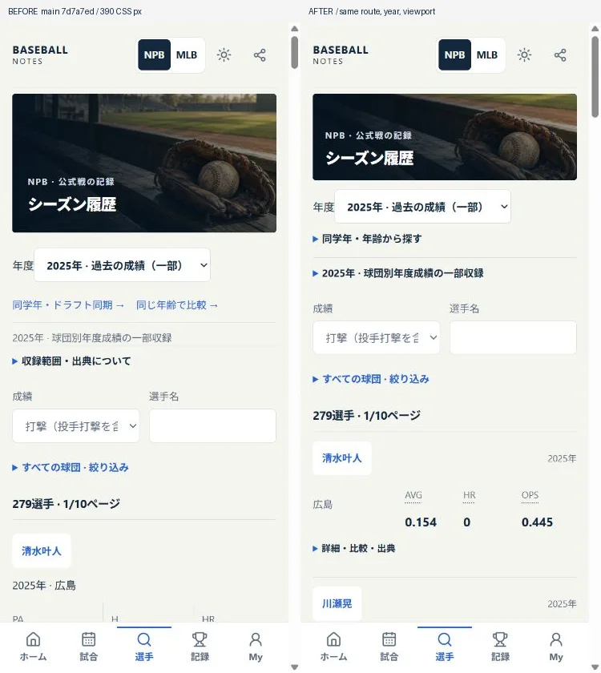
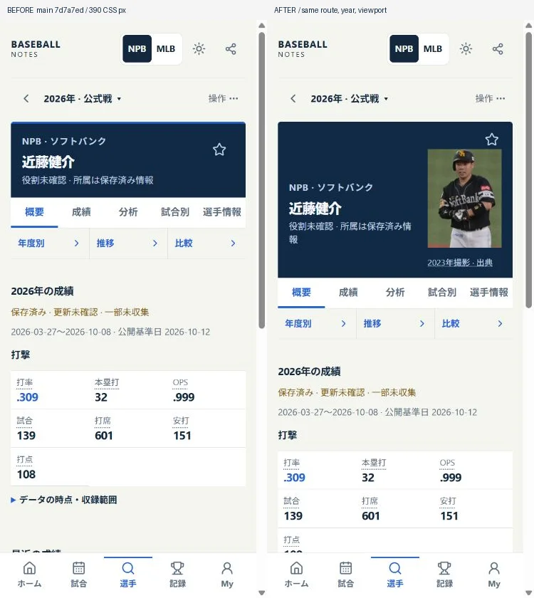
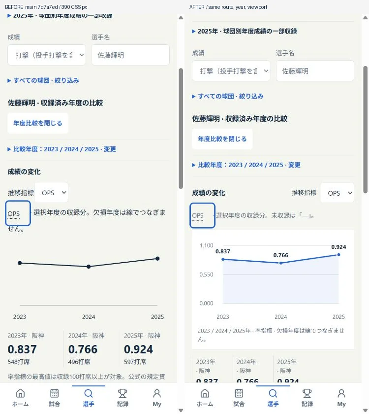

# UI reconstruction: screen acceptance and completion boundaries

Baseline: PR #69, main `7d7a7ed`. Review date: 2026-10-24 JST. PR #70 extends the shipped reconstruction; it is not another redesign of the data model. Competitive evidence and the original generated-image prompts remain in [editorial-ui-redesign.md](editorial-ui-redesign.md), and Home/Player composition evidence in [ui-composition-follow-up.md](ui-composition-follow-up.md).

## Problems actually corrected

- **Compare:** names, criteria, a repeated one-metric summary and supporting links pushed the actual comparison below the first phone screen. Results now precede secondary search/conditions; two selected players share one aligned, semantic table at standard text size. Four-player comparison and labelled rows at enlarged system text remain. Mixed publication dates still block comparison; missing values remain `—`, actual zero remains zero; all roles, conditions, explanations and CSV remain available. No new ranking/"winner" calculation.
- **NPB Historical:** thirty full repeated cards, detailed metrics, tools and lengthy credits made the directory hard to scan. Each player now has a name, distinct team-season rows and three role-specific headline values; one labelled disclosure preserves all other statistics, comparison selection, Favorites, year progression and original article/revision/license. Different transfer-team rows remain separate. Coverage is visibly partial. Cohort/age discovery stays near the year selector; it is not buried after thirty results. The selected comparison years are summarized before the graph and editable without a long permanent checkbox wall. Player-specific Historical pages use the existing identity composition, including the independently admitted portrait when eligible.
- **Team:** original ID-keyed display accents replace repeated arbitrary monograms in team directories and connect team names in regular/CS/Japan Series/MLB scoreboards. Club hubs use a restrained navy nameplate and put actual wins/losses/ties and saved sample before supplemental actions. Names, visitor/home, zero/unknown and provenance remain authoritative. Colors are an app palette, not official color specifications; no logo/lookalike rights claim. Unsupported/offline MLB years retain the existing follow/compare tools.
- **NPB portrait:** independently identified 近藤健介 is now shown with the dated 2023 photograph in his admitted 2023–2026 profile contexts. The exact canonical/QID/NPB ID bridge, copyright grant, purpose limits, bytes and credits are recorded in [visual-assets-rights.md](visual-assets-rights.md#2026-10-24-npb-informational-portrait-admission). A lower-quality CC0 alternative was rejected after looking at it. Photos are not used to infer present roster/number. No AI face or copied club mark.
- **Year progression:** the old unlabelled line did not let readers judge magnitude. A zero-based labelled axis, exact observation labels and year grid now make the values readable. Rates use a line and subtle area; counts use proportional bars. Missing observations remain dashes and cannot bridge a line across an uncollected calendar year. Pitching height uses integer outs, with baseball innings labels; zero remains distinct from missing. Samples, thresholded bests and source links remain available. The redundant fixed-metric bar comparison is preserved in a disclosure. These are presentation changes, not new calculations or inferred statistics.

Changes are limited to presentation, source-photo attribution and regression evidence. There is no domain/statistics/identity/pin/database/storage migration. Revert the presentation commits to restore the prior layout; the old immutable datasets, favorites, collections, Watch, queries and Android links remain usable. Reference searches identified and removed the superseded Historical scope/heading selectors. No unrelated cleanup.

## All-route phone review

Forty route/state representatives were opened in the actual browser, at **360 CSS px**, in both Light (system preference resolved light) and explicit Dark. The first fast capture sweep contained loading frames, so it was rejected as final evidence. A second, separate navigation/capture pass waited across rendering checkpoints. All **80 final captures** have no root horizontal overflow, no remaining skeleton and all five primary links. The full screenshots and DOM receipts are local ignored evidence in `.data/screen-completion/` (`sweep-light-final.json`, `sweep-dark-final.json`), inspected as five contact sheets per theme. This is a viewport review plus the specific detailed interactions below, not a claim that every possible filter, every historical player or every long-page paragraph was manually exercised.

| Family | Actual representatives / intended outcome |
|---|---|
| Home | NPB seasonal lead/saved scores; MLB 2025 player lead, real stats/photo/results; form fetch remains zero |
| Games | NPB schedule's unknown day is not no-game; MLB 2024-05-27 date navigation and actual score rows |
| Search | NPB 740-player directory and MLB season/name discovery; secondary filters and detail links |
| Clubs | NPB/MLB directories, NPB Tigers saved record; full long names and ID-keyed accents |
| Records | NPB Current gate-closed explanation retained; MLB 2024 real HR list/rank/name/value |
| Compare | NPB empty selection; two actual MLB identities/semantic matrix; four-player/date/error/zero/null conditions covered by regression tests |
| Explorer | NPB/MLB period/role/year/name controls, saved conditions, real filtered results |
| History | NPB 2025 partial directory and 2026 separately saved season; MLB Historical year discovery |
| Team / season comparison | NPB/MLB empty selection and retained role/year/metric tools; existing bars/sample scopes |
| Milestones | NPB saved season progress; incomplete full Career remains unavailable |
| Draft / young | Existing draft years/young/school exploration; 2026 feature, immutable forecasts/results/correction disclosure |
| Postseason | NPB bracket, independently saved CS rows/players, MLB historical bracket; played wins/advantages remain separate |
| Events | Existing sourced article-derived facts with as-of/source/disclosure, never presumed official/current affiliation |
| Personal | NPB/MLB My, Collections, Watch empty/baseline states, saved conditions/history and preferences |
| Reference | NPB/MLB glossary, Sources/individual photo credits, Privacy; long Japanese text and contrast |
| Error / unavailable | Invalid NPB canonical route gives a recovery link; uncollected Preseason remains explicitly unavailable; skeleton/error patterns retained |

Standard body remains 14px, not globally enlarged. Names, results and scores have their own hierarchy; 44px information/button targets are retained. Light and Dark share geometry and explicit focus/selected states. Tables preserve header associations and advanced metrics rather than flattening everything into cards. Native large-text tests verify the Android `data-large-font` layouts without reducing the system font multiplier.

## Visual assets and external limits

The app uses the three already generated/inspected/optimized original atmosphere scenes for stadium, Draft and archive; these are actual app assets, not interface screenshots. They add no fake player, score, sponsor or club logo. This batch adds one genuine licensed NPB photograph (18,284 B); admitted photographs total three (NPB one, MLB two). Image URLs are local hashed assets, lazily displayed; creator/source/license/change links are present. No image or third-party font service, hotlink, paid dependency or added subscription.

The supplied concept is a direction, not permission to insert the real logos/photos it depicts. The **12 NPB / 30 MLB official-source use register and contact routes** remain in the rights document. No official logo file is admitted. The register distinguishes those official-file restrictions from unreviewed independent variants; it does not claim every possible logo variant was individually cleared or forbidden. Until the necessary intended-use rights are resolved, the finished name/color identification is the production fallback. No permission applications are sent without authorization.

## Verification gates

- Full local lint, strict TypeScript, tests and Web build: 174 files, **1,796 passed / one Windows platform skip** after the graph regression addition. Linux must execute the remaining platform test. Current-head CI is recorded after completion, not inferred from an earlier run.
- Vercel build and offline staging preserve the immutable releases: 86 protected staged assets; NPB Historical 600 players / 3,524 rows, partial; CS 12 games / 179 rows; Japan Series seven schedules / zero results; sourced events 28. These are existing release counts, not freshly audited live canonical data.
- Android 36 suite expands to **20 tests**, adding real compact directory/detail/license checks and the actual NPB photo/caption at 200% Light/Dark; the existing Back, deep links, rotation, keyboard, lifecycle, persistence, offline/network, Player/Game/HOT/Draft/CS/history/font regressions remain. Build/run success and actual screenshot acceptance must both be checked before release.
- First 20-test run `40055331833` built the APK/AAB successfully but failed three test assumptions: two tests changed theme through a helper which intentionally navigates Home without restoring the tested route; the third searched an obsolete exact disclosure label. The corrected tests restore the canonical route and click the current labelled scope disclosure, retaining the data/license/200% assertions. This failed run is not counted as acceptance. The final rerun also verifies the actual progression values and captures its 150%/200% Light/Dark rendering.
- Baseline HTTP receipt: 25 protected public assets, old three forecasts, 64 prior candidate observations, frozen final 36 predictions and existing 122 selections unchanged; no canonical request/write. Post-publication independent shell/hash and protected-data readback remains a release gate.
- Initial shell before this batch: 42 files / 2,285,199 B. The portrait adds one 18,284 B local image; presentation/CSS increases remain small and are recorded from the final build. No added JSON/provider/form request; exact-photo display requires one image request. No all-year facts are embedded into initial JavaScript.

## Requirements that cannot be truthfully signed off here

| External dependency | Current evidence / completion condition |
|---|---|
| Pixel / physical TalkBack | `adb devices -l` has no attached device. Latest physical behavior is **NOT RUN**; emulator success cannot fill the [physical QA sheet](android-physical-qa-results.md). No uninstall/data clear/key change. |
| Turso latest Current DB success views | Existing SQL read restriction is not assumed lifted. No repeated probe, expensive diagnostic, quota bypass or healthy/complete assertion. Static saved displays are tested independently. |
| Official marks / additional unconfirmed portraits | Source-specific intended-use clearance is required; no presumed authorization or AI imitation. The app remains usable and visually identified without them. |
| Play / verified App Links | Existing owner gates: final signing/key custody, host verification, privacy/Data Safety, Console/testing/submission. No keys, assetlinks publication, payment or submission performed. |

All independent implementation/QA work proceeds despite these dependencies. Do not describe this as a complete physical-device, full-logo-rights or live-canonical acceptance. Additional monthly cost remains **¥0**.

## Actual Before / After

Same 390×844 CSS viewport and real data/route per pair, left Before PR #69 main and right After. Raw UI captures are unretouched; only equal-size side-by-side placement and a labelled strip were added.

MLB data screenshot attribution: The information used here was obtained free of charge from and is copyrighted by Retrosheet. Interested parties may contact Retrosheet at www.retrosheet.org. NPB historical screenshots derive from the individually linked Wikipedia yearly tables (CC BY-SA 4.0), including [清水叶人 revision 108147352](https://ja.wikipedia.org/w/index.php?title=清水叶人&oldid=108147352), [川瀬晃 revision 110861608](https://ja.wikipedia.org/w/index.php?title=川瀬晃&oldid=110861608) and [佐藤輝明 revision 111176542](https://ja.wikipedia.org/w/index.php?title=佐藤輝明&oldid=111176542); changes: excerpting/normalizing and screen layout. Historical and NPB-photo comparison sheets are CC BY-SA 4.0. Photo: Orixbaseballclub, [source/revision](https://commons.wikimedia.org/w/index.php?curid=130403896&oldid=1285332938), [CC BY-SA 4.0](https://creativecommons.org/licenses/by-sa/4.0/), resized/WebP/CSS clipping. No application source-code relicensing.
