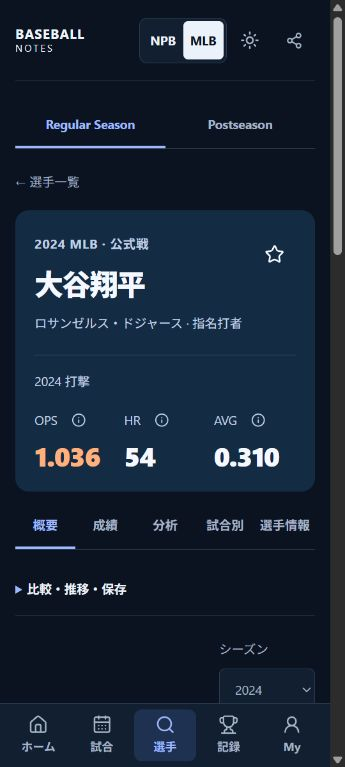
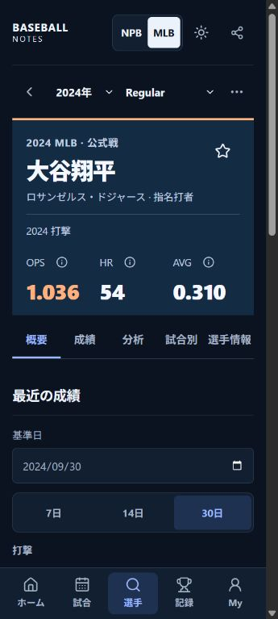
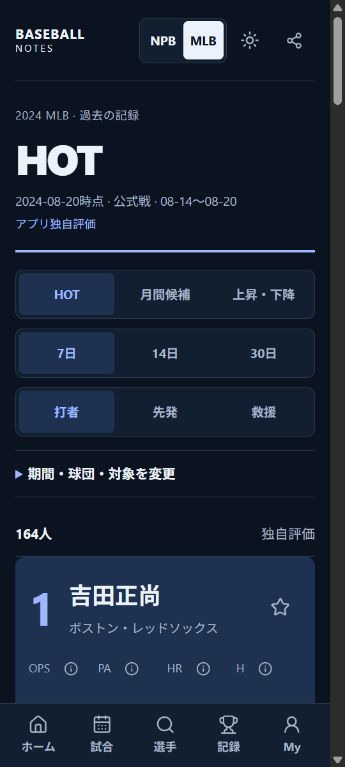
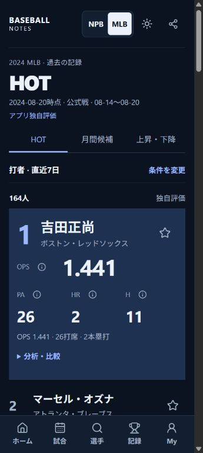
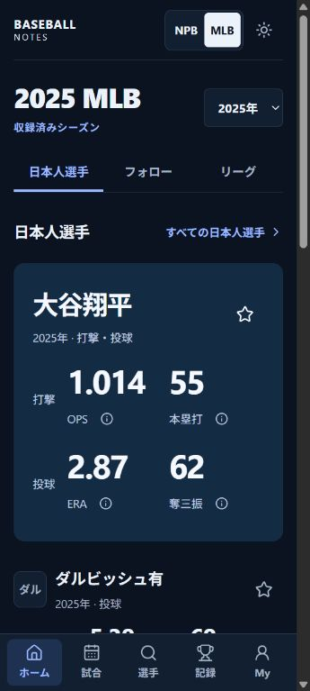
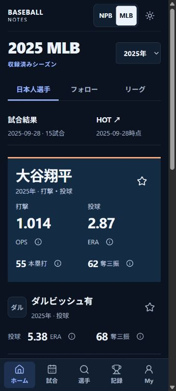
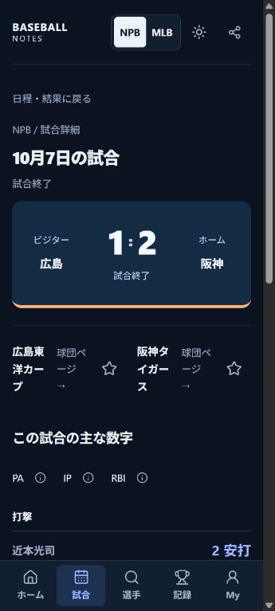
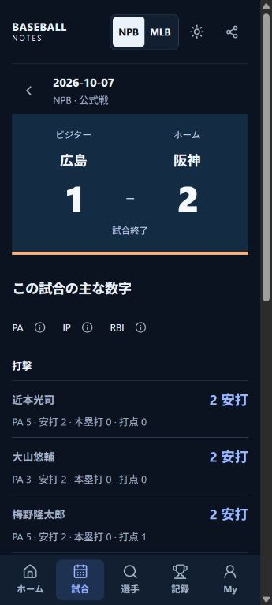

# Final visual refinement — PR #26 follow-up

2026-10-12. Baseline: `5f19db7` (PR #26). This is a presentation refinement, not another redesign or a data release. The final PR delivery comment records the reviewed SHA, CI, merge, Pages run and post-publication verification.

## Problems found and decisions

| Screen | Observed problem | Refinement |
|---|---|---|
| Player | Competition, Back, identity, tabs, tools and year formed six separate vertical layers. The displayed year selector followed the headline. | One context row above identity contains Back, year, competition and an accessible action menu. Name and recorded role-specific headlines follow immediately, then five readable tabs. NPB has its actual single-year context. |
| HOT | Three large segmented control rows put the leader below the first screen's useful area. | Keep the three view modes as flat tabs. Show active category/window in one expandable condition row; retain year, scope, date, team, Favorites, role and comparison filters inside it. Rank 1 leads; remaining entries stay compact. Desktop leader separates identity/reason from figures. |
| MLB Home | The featured player's two stat sets were tall; a duplicated Japanese-player heading and repeated discovery routes competed with the data. | Align actual batting/pitching headline figures, make secondary HR/K inline, use compact following rows. Show selected-year Games/HOT once before players. No form-projection request is added. |
| Game | Back/heading/actions delayed the score. Wide team names squeezed central numbers. | A compact dated context row precedes opposed teams and a full-width score row. Status remains explicit. Recap follows before disclosed team actions; Box Scores remain available. |
| Team | Badge and oversized name left a final character on its own line at 360px. | Smaller badge, balanced name wrapping and reduced padding; record and team data unchanged. |
| Dialog | Opening Collections from the new action dialog could leave document scrolling locked when a route unmounted both dialogs. | Reference-count document scroll locks; preserve native modal focus/Escape/Android Back. Regression tests cover nested closure and simultaneous unmount. |

No portrait/logo/decorative asset, font, dependency, provider or new metric is introduced. Existing theme tokens and Lucide operation icons are retained. Obsolete `.player-tools` rules were removed after reference checks; the separate future-feature tools are retained.

## Competitive recheck

These are first-party public screenshots/marketing UI and a published leaderboard screenshot, not installed native applications. No competitor material is bundled in the app. Font/tap-target dimensions of competitors were not measured.

| Reference | Actually inspected | Principle adopted | Deliberately excluded |
|---|---|---|---|
| [Apple Sports](https://www.apple.com/newsroom/2024/02/introducing-apple-sports-a-new-app-for-sports-fans/) | Official game screenshot | Opposed team identity, dominant score, compact context | Live coverage claims, official assets and copied screen styling |
| [NPB+](https://www.sony.co.jp/news-release/202510/25-038/) | Official app screenshot | Baseball result before secondary detail | Pitch-by-pitch data or unlicensed team/portrait assets |
| [スポナビ野球速報](https://sports.yahoo.co.jp/promo/app/bblive/) | Official phone preview and Japanese navigation | Familiar result/date/box-score vocabulary | Unavailable starters, live commentary and news |
| [Sofascore](https://www.sofascore.com/news/sofascores-new-home-screen-a-smarter-faster-way-to-follow-sports) | Official Home preview | Pinned context and compact controls; results before deeper tools | Ratings and live-event assumptions |
| [FotMob](https://www.fotmob.com/download) | Official mobile landing UI; previous reconstruction research's phone previews | Progressive detail and clear followed-entity entry points | This recheck did not operate the native app or verify every current native screen |
| [MLB](https://www.mlb.com/apps/mlb-app) | Official mobile app landing page | Team/player emphasis, recognizable baseball section names | Native Player screens were not accessible here; no claim of native-screen QA |
| [FanGraphs](https://blogs.fangraphs.com/wp-content/uploads/2023/08/FG-Updated-MLB-Leaderboards-1536x1262.png) | Published leaderboard screenshot | Aligned statistics and explicit scope, secondary filters | Desktop table density as the mobile default |

The app's distinctiveness comes from editing: a scoped Player identity block, symmetric scoreboard, ranked HOT feature plus dense rows, and Japanese-player Home figures. It does not come from extra decorative cards or icons.

## Same-condition Before / After

Native JPEG browser captures at **360×800, Dark**. The image excludes browser chrome/scrollbar; DOM viewport width was checked separately. All show the existing real public data. No fixture or manipulated composite is used.

| Screen | Before PR #26 | After refinement |
|---|---|---|
| 大谷翔平 · 2024 Regular |  |  |
| HOT · 2024-08-20 / 7 days / batters |  |  |
| MLB Home · 2025 / Japanese players |  |  |
| NPB Game · 2026-10-07 / 広島–阪神 |  |  |

Measured document positions at the top of the page (CSS px, rounded):

| Measure | Before | After |
|---|---:|---:|
| Player year selector top | 658 | 97 |
| Player identity top | 219 | 153 |
| Player tabs top | 525 | 416 |
| HOT first player top | 580 | 369 |
| Home featured player height | 322 | 256 |
| Home second player top | 637 | 587 |
| Game score top | 263 | 151 |

Self-assessment: first-screen hierarchy and result access are materially better. Player has selected-year context before figures; HOT exposes the first player's sample and reason in the initial view. Home's second player is visible sooner, and Game reads as a score/result screen. Data-heavy secondary screens still require considered expansion/scrolling; photographs and logos are not prerequisites for this improvement and remain rights-dependent.

## Browser QA and its limits

Operated public baseline and local Chrome, then the deployed app. Important samples: Ohtani 2024 batting-only and 2023 with actual batting/pitching sets; NPB Chikamoto with partial Season; NPB Carp–Tigers 1–2 and MLB Dodgers–Marlins 20–4. Scope switching 2024 Regular/Postseason, year changes while on Analysis, menu paths, Game-to-Player, native Escape/return focus, nested Collection dialog route exit, browser Back and Reload were checked.

| Family | Current-batch visual checks |
|---|---|
| Home | NPB saved games/unknown current schedule; MLB selected-year Japanese players, Light/Dark, 360/390 and desktop |
| Player | MLB/NPB overview; MLB Analysis/Game Log; actual year and competition change; 360/390 Light/Dark and tablet |
| HOT | Weekly leader/list; monthly mid-month label; starter category and filter open/close; 360/390 Light/Dark and desktop |
| Game | NPB and MLB actual score/Recap; 360 Light/Dark, 390 and tablet; long MLB team names |
| Team / Records | NPB Tigers long name, partial team record and gated Records; no public ranking leaked |
| Analysis / Compare / MATCHUP | Actual Ohtani/Yoshida comparison, Player Analysis, empty MATCHUP selector |
| Explorer / History / Draft | Data results/disclosed filters, saved-season history, NPB Draft rows/coverage context |
| Personal / help | My, Watch baseline/empty, Collections empty, glossary; no existing saved entries reset |
| Invalid states | Invalid canonical ID and unsupported historical scope are safe fallbacks; real loading transitions observed |

No horizontal document overflow was observed in the completed samples. Closed tables retain their existing bounded scroll regions when expanded. This is sample-based visual QA, not a claim that every possible filter combination, local state or network failure was photographed. Existing full tests cover Recent/date windows, as-of/scope/role semantics, partial/missing/error responses, offline saved-response validation, schema migration/corruption/quota and persistence.

Physical Android, TalkBack, actual disconnected cold start, hardware scroll performance and signed App Links/Play release remain manual. The browser surface used here does not expose network-offline emulation. No generated scheduled game or fake error was inserted into production for screenshots.

## Performance and protected boundaries

- Initial JS: baseline **482.43KB / 149.18KB gzip**; refinement about **482.52KB / 149.22KB gzip**. Historical reader remains lazy **455.68KB / 140.21KB gzip**.
- Compiled CSS: baseline about **62.00KB / 11.40KB gzip**; refinement about **65.3KB / 11.9KB gzip**. Scope-specific layouts replace removed obsolete tools styles; no second token layer or end-of-file global override stack.
- New public data payloads: **0**. Home additional form reads: **0**. Existing maximum four profile reads, HOT 20 rows/page, Explorer 40 and Compare 2–4 entities remain.
- Canonical DB writes: **0**. No diff to domain/application/infrastructure, data/pipelines, workflows, source policy or Android adapter. Favorites/Collections/Saved Views/Activity/Watch schemas and keys are unchanged.
- NPB Current remains saved/partial where applicable, HOT and Ranking Gates closed. MLB remains Historical **2014–2025**, Regular and Postseason separated. Player headline is full selected-Season totals; its Recent section alone uses the selected as-of date. An as-of label must not imply that full-season totals were truncated.
- Before-publication read-only HTTP validation: **45 requests PASS**, including seven protected NPB payload hashes, two old MLB hashes, twelve-year Regular/Postseason manifests and canonical count/identity checks. Full app-only staged-data preservation and after-publication HTTP results belong to the final delivery evidence.

Initial refinement checkpoint: **102 files / 1,178 tests**, lint, strict typecheck, Web and Vercel build PASS. Codex Review found one P2: a scope with no corresponding Player profile hid the scope control as well. Recovery controls now remain in missing/loading/error and unrecorded-season states, without fictitious Player actions. Four additional tests cover both scope directions and error/loading recovery. The final **1,182-test** full run and exact-head Android build are recorded in the PR delivery evidence. Build success is not device QA.

## Remaining

Further user testing of deep analytical filters and action-menu discoverability is useful. No broad secondary-screen redesign is justified by this refinement alone. NPB current roster/number, full Historical/Career, Current Postseason, transactions/FA/Posting/preseason and rights-dependent assets/metrics remain Source/Data Quality work. MLB Current, Push and background delivery are not introduced.
